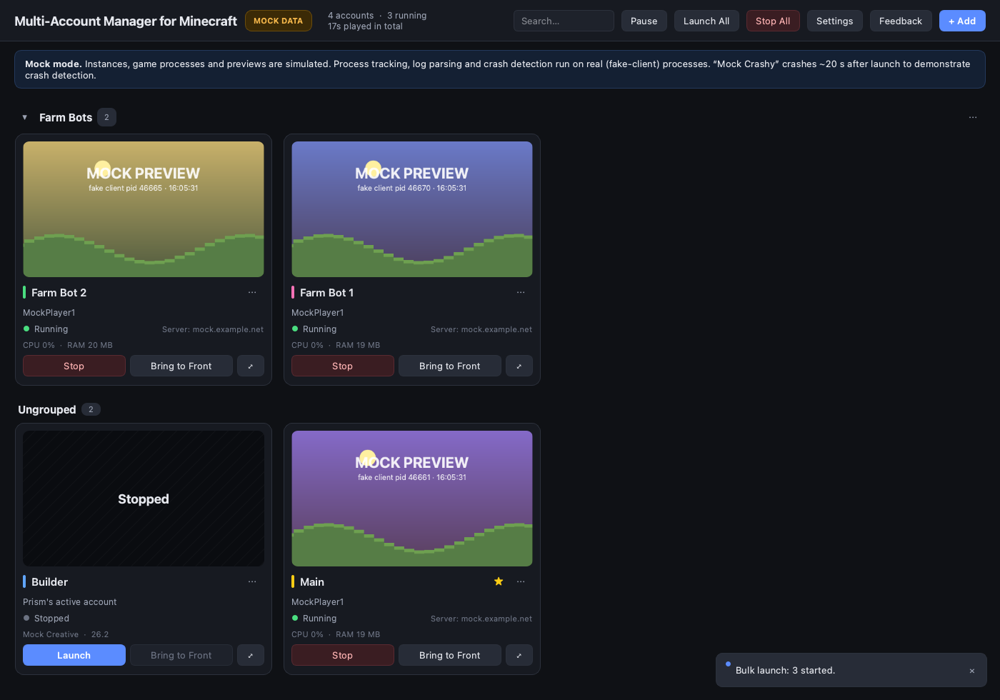
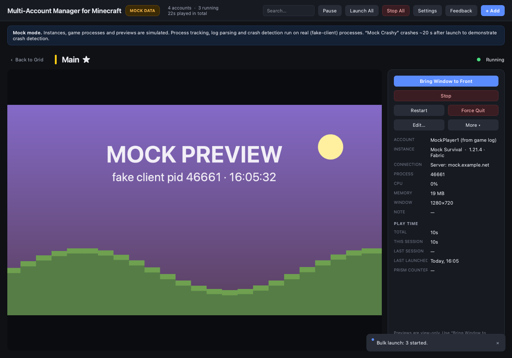
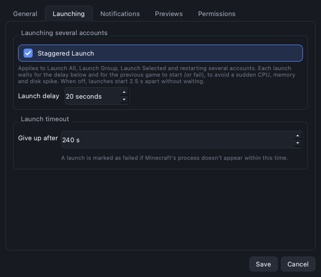

# Multi-Account Manager for Minecraft

A macOS dashboard for running several Minecraft: Java Edition accounts at once. It launches
your instances **through [Prism Launcher](https://prismlauncher.org)**, tracks every game
process, shows a **live preview of each real game window**, and brings any game to the front
so you can play it with your normal mouse and keyboard.

> Not an official Minecraft product. Not approved by or associated with Mojang or Microsoft.
> Not affiliated with Prism Launcher.



<sub>Screenshots are taken in mock mode (`--mock`), which uses simulated instances and preview images.</sub>

## Features

- **Live previews** of every running game window (ScreenCaptureKit), plus an expanded view
  with a larger, faster preview.
- **Launch, stop, restart, force quit** through Prism Launcher; **Bring to Front** for the
  real game window. Already-running games are picked up when the dashboard opens.
- **Custom display names**, colour labels and favorites for each account.
- **Groups**: create, rename, pin, collapse and reorder groups; drag tiles between them.
- **Multi-select** (click, ⌘-click, Shift-click, ⌘A) with **bulk actions**: launch, stop or
  restart only the selected accounts.
- **Staggered Launch**: start many accounts one after another with a configurable delay,
  waiting for each game to actually start; cancellable, and a failure never blocks the queue.
- **Play time** per account (total, current and last session) and in total.
- **Notifications** for crashes, launch failures, started games and bulk-launch results, each
  category switchable.
- **Crash detection** from Minecraft's crash reports; username and server parsed from the game
  log (best effort).

| Expanded view | Settings |
|---|---|
|  |  |

## Requirements

| | |
|---|---|
| macOS | **14 Sonoma or later** for the packaged app (its Qt version needs 14). Tested on macOS 15.3. From source, macOS 13 can work with an older PySide6 (previews then use a legacy capture method). |
| Mac | **Apple silicon** (M1 and newer) or **Intel**: there is a separate download for each, see [Which download?](#which-download). The Intel build has so far only been tested under Rosetta 2, not on a real Intel Mac. |
| Prism Launcher | Installed (preferably in `/Applications`), with at least one instance and a signed-in Microsoft account. Tested with Prism Launcher 11.1.1. |
| From source only | Python 3.11+ from [python.org](https://www.python.org/downloads/macos/) (tested with 3.14). |

## Getting the app

There are three ways to run it:

| | Who it's for | Needs |
|---|---|---|
| **A. Prebuilt app** | Most users | Nothing but the download (once releases exist) |
| **B. Run from source** | Developers, trying changes quickly | Python, Terminal |
| **C. Build the app yourself** | Anyone who wants the .app from current source | Python, Terminal, ~1 minute |

### A. Prebuilt app

#### Which download?

Check **Apple menu › About This Mac**: *Chip: Apple M…* means Apple silicon; *Processor: Intel…* means Intel.

| Your Mac | Download from [Releases](https://github.com/nicolbolas123/multi-account-manager-for-minecraft/releases) |
|---|---|
| **Apple silicon** (M1, M2, M3, M4… chips) | `Multi-Account-Manager-for-Minecraft-<version>-macOS-AppleSilicon.zip` |
| **Intel** (Macs that can run macOS 14 Sonoma: generally 2018 or newer, iMac 2019 or newer) | `Multi-Account-Manager-for-Minecraft-<version>-macOS-Intel.zip` |

Both need macOS 14 Sonoma or later. The Intel build also opens on Apple silicon (through Rosetta
2), but slower; use the Apple silicon download there. Release v0.1.0 has an Apple silicon
download only (named `…-arm64.zip`).

#### Installing

1. Download the zip for your Mac. Optionally compare its checksum with the one on the release
   page: `shasum -a 256 ~/Downloads/<file>.zip`.
2. Double-click the zip and drag **Multi-Account Manager for Minecraft** to Applications.
3. Open it (see the next paragraph the first time), then grant the
   [permissions](#permissions) it asks for: Screen Recording for previews, and optionally
   Accessibility and Notifications.

Release builds are **not signed with an Apple Developer ID and not notarized** (yet), so macOS
blocks the first launch with *"Apple could not verify … is free of malware"*. To open it anyway:
open it once, then go to **System Settings › Privacy & Security**, scroll to the message about
the app and click **Open Anyway** (macOS 15 no longer offers right-click › Open for this).
Only do this for a download you trust. See [docs/DISTRIBUTING.md](docs/DISTRIBUTING.md) for the
plan to sign and notarize releases.

### B. Run from source

```bash
git clone https://github.com/nicolbolas123/multi-account-manager-for-minecraft.git
cd multi-account-manager-for-minecraft
./run.sh            # creates .venv and installs dependencies on first run, then starts the app
./run.sh --mock     # simulated instances, games and previews: try it without Minecraft
./run.sh --debug    # verbose logging
```

`run.sh` uses `python3` from your PATH. When run this way, macOS grants permissions to your
**terminal app** (Terminal, iTerm…), and notifications appear as coming from "Script Editor".

### C. Build the app yourself

Requires Python 3.11+ from [python.org](https://www.python.org/downloads/macos/) (its
"universal2" installer; release builds use 3.14) and the Xcode command-line tools
(`xcode-select --install`).

```bash
packaging/setup_signing.sh             # once per Mac (optional but recommended, see below)
packaging/build_app.sh                 # this Mac's architecture -> dist/Multi-Account Manager for Minecraft.app
packaging/build_app.sh --arch arm64    # Apple silicon -> dist/arm64/…app
packaging/build_app.sh --arch x86_64   # Intel         -> dist/x86_64/…app
packaging/build_app.sh --skip-tests    # faster rebuild
packaging/build_app.sh --check         # is the app up to date with the source? (add --arch to check that one)
```

Open the result from Finder, or copy it to /Applications. Quit the app before rebuilding it.

| Building on | arm64 (Apple silicon) | x86_64 (Intel) |
|---|---|---|
| Apple silicon Mac | native | under **Rosetta 2** (`softwareupdate --install-rosetta`); tests and checks run as x86_64 |
| Intel Mac | not possible (an Intel Mac can't run the tests or the app) | native |

The script stops with an explanation if the Mac or the Python can't build the requested
architecture (for example Homebrew's arm64-only Python, or Rosetta 2 missing).

What the build does: it creates an environment per architecture (`build/venv-<arch>`, work files
in `build/pyinstaller-<arch>`), installs the pinned versions in `packaging/constraints.txt`, runs
the test suite as that architecture, builds with PyInstaller (`packaging/mcmanager.spec`), signs
the app, and then verifies it: every executable and library has the right architecture and links
only to the bundle or macOS (`packaging/verify_bundle.py`), bundle identity, signature, the app's
own `--self-check` run as that architecture (every dependency and resource loads from inside the
bundle), included license files, and a fingerprint of the source it was built from. It never reads
or writes your app data.

**Release zips**: `packaging/make_release.sh dist/<arch>/*.app` writes
`dist/release/…-macOS-AppleSilicon.zip` or `…-macOS-Intel.zip` plus a `.sha256` file. The
[Build macOS apps](.github/workflows/build-macos.yml) GitHub Actions workflow builds both on
native Apple silicon and Intel runners. See [docs/DISTRIBUTING.md](docs/DISTRIBUTING.md).

**Signing for your own Mac.** `packaging/setup_signing.sh` creates a self-signed certificate,
"Minecraft Manager Local Signing", in your login keychain (free, valid 10 years, usable only by
`codesign`, trusted only on this Mac). The build signs with it, so every rebuild has the same
identity and **macOS keeps the app's permissions**. Without it the build falls back to **ad-hoc
signing**: macOS then identifies the app by a hash of its exact contents, so after every rebuild
the permissions still look enabled in System Settings but don't apply (fix: remove the app from
the list with **−** and add it again). Neither kind of signature makes the app trusted on other
Macs. To remove the certificate: Keychain Access › login › My Certificates.

## Setting up Prism Launcher

1. **Install Prism Launcher in /Applications.** Running it from Downloads works, but macOS runs
   quarantined apps from a temporary copy. The dashboard finds Prism by its bundle identifier;
   you can also point Settings › General at it.
2. **Sign in** to your Microsoft account(s) in Prism and create an instance.
3. **To run several accounts at the same time, give each account its own instance** (in Prism:
   right-click an instance › Copy). Prism runs each instance only once at a time.
4. In the dashboard, **+ Add** an account for each instance (or **Add All Prism Instances**) and
   pick which Prism account profile it uses.

The dashboard uses only Prism's documented command-line options (`--launch`, `--profile`,
`--show`, `--dir`). Prism handles sign-in; this app never reads or stores tokens.

## Permissions

| Permission | Needed for | Granted to |
|---|---|---|
| **Screen & System Audio Recording** | Live previews | The app (or your terminal app when run from source) |
| **Accessibility** (optional) | Restoring minimized windows; closing a game through its window instead of a quit signal | Same |
| **Notifications** (optional) | Crash / launch / bulk-launch alerts | The app asks the first time (Settings › Permissions › Request) |

Settings › Permissions shows the current state of all three. After changing Screen Recording or
Accessibility, quit and reopen the app.

## Using it

- **Tiles** show the live preview, display name, username (from the game log), status, server
  (best effort), CPU and RAM. Double-click or **⤢** opens the expanded view; **⋯** or right-click
  gives rename, edit, restart, force quit, favorites, move to group, open folder, show in Prism and
  remove. Buttons never change the selection.
- **Selecting**: click a tile; **⌘-click** adds or removes one; **Shift-click** selects a range
  (in on-screen order, across groups); **⌘A** selects all visible; **Esc** or a click on empty
  space clears it. Dragging a selected tile moves the whole selection.
- **Bulk toolbar** (while tiles are selected): Launch / Stop / Restart Selected and Deselect All.
  Stop and Restart list the affected accounts and ask first.
- **Groups**: right-click empty space › **Add Group…**. Drag tiles into a group, between tiles
  to reorder, or into **Ungrouped**. Right-click a group to rename, pin to top, move up/down,
  collapse, launch or stop it, or delete it (its accounts move to Ungrouped).
- **Staggered Launch** (Settings › Launching): multi-account launches start one at a time. Each
  waits for the **Launch delay** (default 20 s, 1–600 s) *and* for the previous game to appear
  or fail. A progress bar shows who is launching and waiting, with **Cancel Waiting Launches**.
  When off, launches start 2.5 s apart.
- **Play time**: the header shows the combined total; the expanded view shows each account's
  total, current session, last session and last launch.
- **Notifications** (Settings › Notifications): master switch plus independent categories, and a
  test button.
- Closing the dashboard does **not** close your games; it re-attaches to them when reopened.
  Only one copy of the dashboard can run at a time.

## Your data and privacy

Everything the app stores is on your Mac, outside the repository and outside the app bundle, so
updating or rebuilding the app never touches it:

| What | Where |
|---|---|
| Settings (accounts' display names, groups, order, preferences) | `~/Library/Application Support/MinecraftMultiAccountManager/settings.json` |
| Play-time history | `playtime.json` in the same folder |
| Logs (app, Prism command output) | `~/Library/Logs/MinecraftMultiAccountManager/` |
| Mock-mode demo data | `~/Library/Caches/MinecraftMultiAccountManager/mock/` |

From Prism the app reads instance folders and the **profile names** in `accounts.json` (never
tokens). It reads the games' `logs/latest.log` and crash reports. It sends nothing over the
network. Logs contain your Minecraft username and server names, so check them before attaching
them to an issue.

## Troubleshooting

| Problem | Fix |
|---|---|
| A permission is on in System Settings but the app says it's off | The app's signature changed (an ad-hoc rebuild). Remove the app from that list with **−**, add it with **+**, reopen. Run `packaging/setup_signing.sh` once so it doesn't happen again. |
| "Prism Launcher was not found" | Install Prism in /Applications, or set its location in Settings › General. |
| A launch fails or times out | Open Prism Launcher and check for sign-in, download or Java errors; see `~/Library/Logs/MinecraftMultiAccountManager/prism-cli.log`. |
| "Instance is already in use" | Prism runs each instance once. Copy the instance in Prism for each account. |
| Previews stay black / "permission needed" | Grant Screen Recording (see [Permissions](#permissions)), then quit and reopen. Minimized windows can't be captured. |
| Test notification doesn't appear | Packaged app: allow it in System Settings › Notifications › Multi-Account Manager for Minecraft and check Focus. From source: allow notifications for **Script Editor**. |
| "… is already open" | Another copy (the app or `./run.sh`) is running; switch to it. |
| macOS says the downloaded app can't be verified | See [Prebuilt app](#a-prebuilt-app). |

## Known limitations

- **The Intel build hasn't been tested on a real Intel Mac yet**, only under Rosetta 2 on Apple
  silicon (see below). Reports from Intel users are very welcome.
- **macOS 14 Sonoma or later** for the packaged app.
- **No Developer ID signature or notarization** yet, so downloaded builds need Open Anyway.
- **No input forwarding** into previews; macOS has no reliable, supported way to send input to one
  specific background window. Use Bring to Front.
- **Minimized windows can't be captured** (macOS doesn't render them); the tile keeps its last frame.
- **Server disconnects can't be detected**: the client log has no dependable "disconnected" line,
  so that notification is shown as unavailable rather than guessed.
- **Username, server and clean-exit detection are parsed from `latest.log`** and may not match
  every version or mod setup.
- **Play time is game-process time**, not time connected to a server; sessions from before the
  feature existed aren't counted (Prism's own per-instance counter is shown for reference).
- A launch can't be cancelled from the dashboard before the game process exists (use Prism).
- macOS 15 may periodically re-confirm Screen Recording permission.

### Supported architectures

There are two separate builds, each containing only its own architecture:

| Build | Runs on | Status |
|---|---|---|
| **Apple silicon** (arm64) | M1 and newer, macOS 14+ | Built natively and tested with real Minecraft |
| **Intel** (x86_64) | Intel Macs with macOS 14+ | Built and tested under Rosetta 2 (all binaries checked, tests and mock mode pass); **not yet run on a real Intel Mac** |

There is no universal build: psutil publishes separate Intel and Apple silicon packages, so a
universal app would need hand-merged libraries and would be twice the download. Details:
[docs/DISTRIBUTING.md](docs/DISTRIBUTING.md).

## Development

```bash
./run.sh --mock                         # try the UI without Minecraft
.venv/bin/pip install -r requirements-dev.txt
.venv/bin/python -m pytest              # ~80 tests, offscreen, mock backends only
.venv/bin/python -m mcmanager --self-check
.venv/bin/python docs/make_screenshots.py   # regenerate README screenshots (mock mode)
```

See [CONTRIBUTING.md](CONTRIBUTING.md). Project layout:

```
mcmanager/
  app.py              entry point and wiring (real or --mock backends), --self-check
  bundle.py           source-vs-packaged helpers (resources, clean environment for child processes)
  config/settings.py  persisted settings and DashboardEntry (JSON, atomic writes)
  prism/              Prism discovery, instance/account listing, CLI launching
  runtime/
    process_finder.py find the JVM for an instance; safe signalling
    log_watcher.py    tail logs/latest.log → username / connection / clean exit
    poller.py         background thread: processes, windows, logs, CPU/RAM
    manager.py        entries + per-entry state machine (launch/stop/crash…), app events
    launch_queue.py   sequential / staggered multi-account launching, cancellable
    playtime.py       per-account sessions and totals (playtime.json)
    previews.py       chooses what to capture, how often, how large
  notifications.py    notification policy, de-duplication, delivery
  windows/            macOS: window discovery, capture backends, focus, permissions
  mock/               clearly separated simulated environment (--mock)
  ui/                 PySide6 dashboard
packaging/            build script, PyInstaller spec, icon, signing setup, license texts
tests/                pytest suite
docs/                 distribution notes, screenshots
```

### How it works

- **Prism integration.** Prism is single-instance, so the game JVM is not this app's child. It's
  identified by `-Djava.library.path=<instance>/natives` or a working directory of
  `<instance>/minecraft`. Before any signal is sent, the process's creation time and command line
  are checked again, so unrelated Java processes are never touched. Child processes (Prism,
  `osascript`) get an environment without the packaged app's private Qt/Python variables.
- **Play time** is tracked here, not taken from Prism (Prism's counters are per instance, have no
  history and only count launches Prism supervised). A session is one game process, identified by
  (pid, start time), so polling, re-attaching or restarting never double-counts. Open sessions are
  saved every 60 s; if a game ends while the dashboard is closed, its session ends at the last save
  and is marked *estimated*. Data is keyed by each entry's UUID.
- **Notifications**: the packaged app uses Apple's UserNotifications framework (its own entry in
  System Settings); from source it falls back to `osascript`, and to in-dashboard messages where
  neither is available. Errors are always shown in the dashboard and the log.
- **Capture**: ScreenCaptureKit (`SCScreenshotManager`, macOS 14+), falling back to Quartz
  `CGWindowListCreateImage`.

## Feedback

Suggestions and bug reports: [open an issue on GitHub](https://github.com/nicolbolas123/multi-account-manager-for-minecraft/issues) or DM **nicolbolas123** on
Discord (also available in the app's **Feedback** menu).

## License

[MIT](LICENSE): you can use, copy, modify, merge, publish, distribute, sublicense and sell this
software freely; the only condition is keeping the copyright notice and license text in copies.
It comes with no warranty.

Third-party components and their licenses (notably Qt/PySide6 under LGPL-3.0) are listed in
[THIRD_PARTY_NOTICES.md](THIRD_PARTY_NOTICES.md); their license texts are included in the app.
